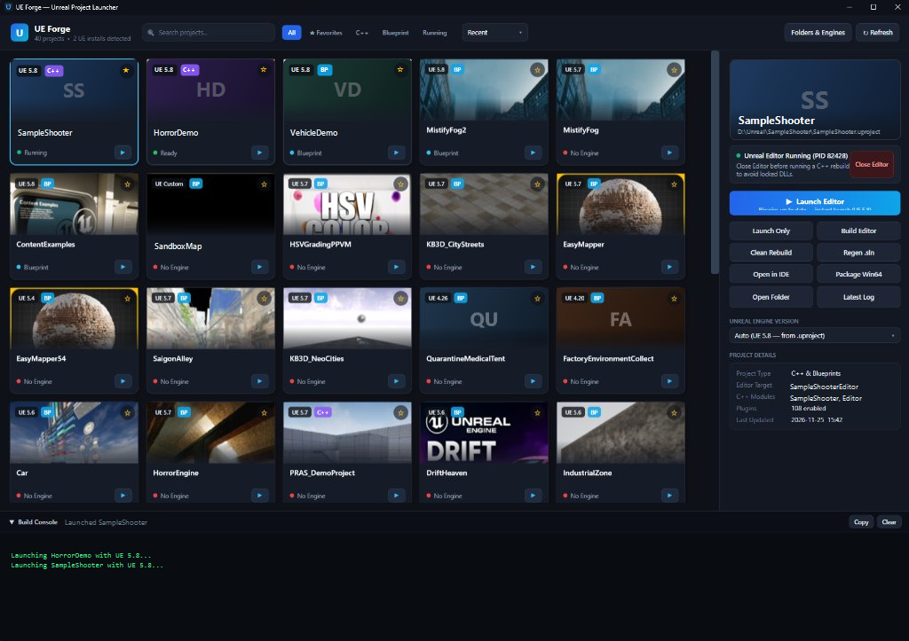

# UE Forge

A fast, lightweight, dark-mode Windows desktop launcher and C++ builder for Unreal Engine 4/5 projects — designed as a clean, reusable replacement for per-project `BuildAndRun.bat` scripts.



## Features

- **Multi-Project Auto-Discovery:** Scans one or more configured project folders for `*.uproject` files, automatically reading thumbnails (`<Project>.png` / `Saved/AutoScreenshot.png`), engine versions, C++ vs Blueprint status, and `Source\*Editor.Target.cs` targets (including custom targets such as `LyraEditor`).
- **Multi-Drive Engine Detection:** Automatically detects installed Unreal Engine builds across Windows Registry, Epic Games Launcher (`LauncherInstalled.dat`), and common install paths on `C:`–`G:`, plus custom/source engine builds.
- **Smart Build & Run (1-Click):** Compares C++ source/plugin timestamps against `Binaries\Win64\*.dll`. Launches `UnrealEditor.exe` immediately when binaries are up-to-date (or for Blueprint-only projects), and runs an incremental UBT build first only when C++ files changed.
- **Per-Project Running Editor Guard:** Detects whether `UnrealEditor.exe` is running *for that specific `.uproject`*, displays a live **Running** badge with a **Close Editor** button, and prompts cleanly before C++ rebuilds so DLLs aren't locked.
- **Full Developer Action Set:**
  - **Build & Run** / **Launch Only**
  - **Build Editor** (incremental UBT compile)
  - **Clean Rebuild** (clears project & plugin `Binaries`/`Intermediate`, regenerates `.sln`, full compile)
  - **Regen `.sln`** & **Open in IDE**
  - **Package Win64** (`RunUAT BuildCookRun`)
  - **Open Folder** & **Latest Log** (`Saved/Logs/<Project>.log`)
  - **Per-Project Engine Override** dropdown
- **Live Color-Coded Build Console:** Collapsible console drawer streaming UBT/UAT output with `[N/M]` progress bar parsing, elapsed timer, cancel support, and copy/clear actions.
- **Search, Filters & Favorites:** Filter by All, Favorites (`★`), C++, Blueprint, or Running; sort by Recent, Name, or Engine Version. Settings persist in `%AppData%\UELauncher\settings.json`.

## Quick Start (Prebuilt Release)

1. Download `UELauncher.exe` from the [Releases](https://github.com/AlxPalagano/UEForge/releases) page.
2. Make sure the [.NET 9.0 Desktop Runtime (x64)](https://dotnet.microsoft.com/en-us/download/dotnet/9.0) is installed on Windows 10/11.
3. Run `UELauncher.exe` and click **Folders & Engines** to add your Unreal project folders if they aren't auto-detected.

## Build from Source

Requires Windows 10/11 and the [.NET 9.0 SDK](https://dotnet.microsoft.com/en-us/download/dotnet/9.0).

```powershell
dotnet publish UELauncher.csproj -c Release -r win-x64 --no-self-contained -p:PublishSingleFile=true -o publish
```

The single-file executable is written to `publish\UELauncher.exe`.

## License

MIT — see [LICENSE](LICENSE).
